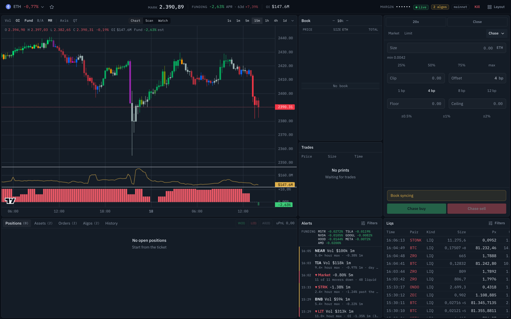
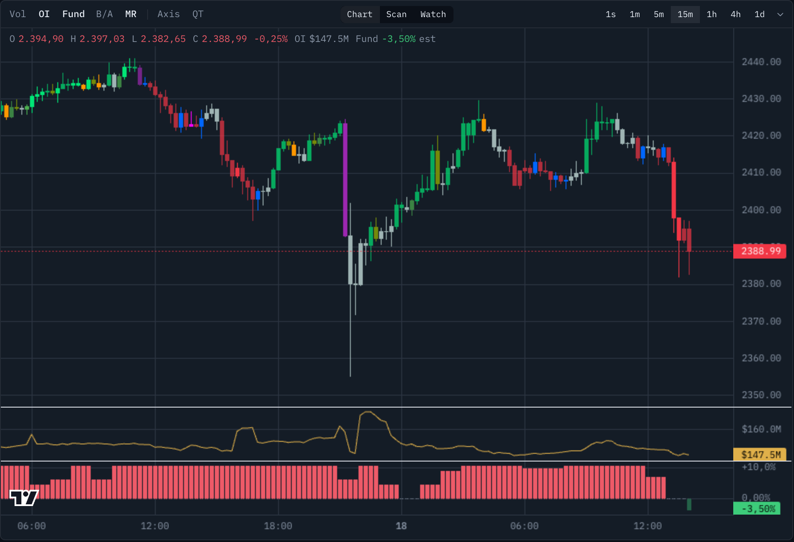
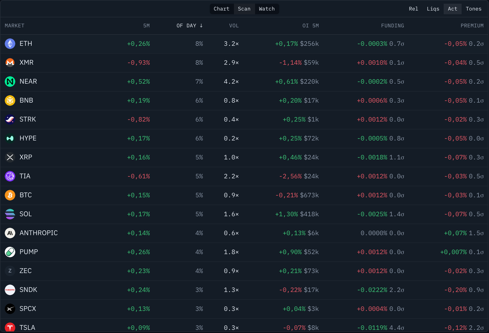
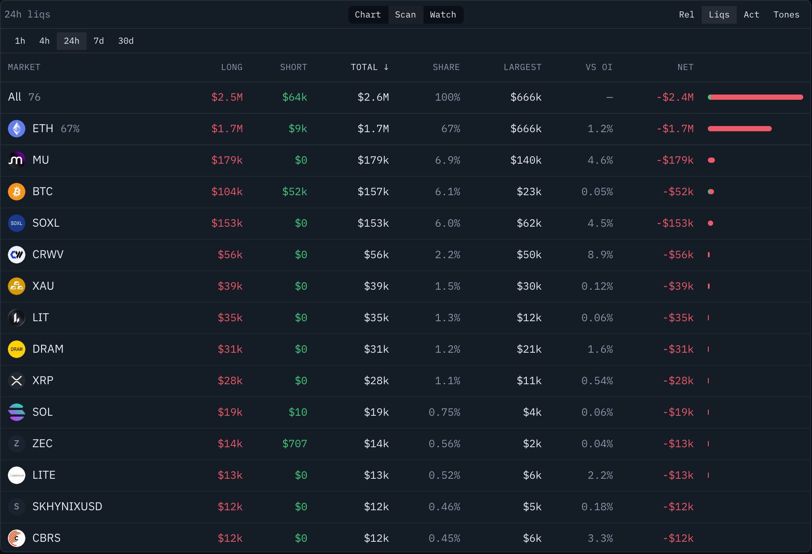
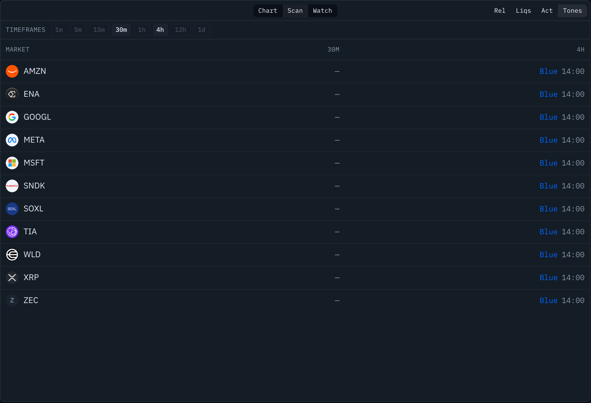
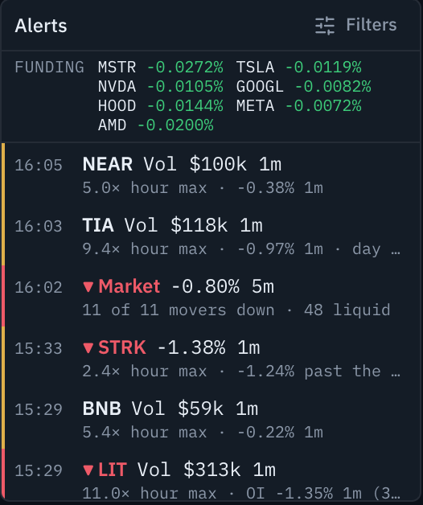
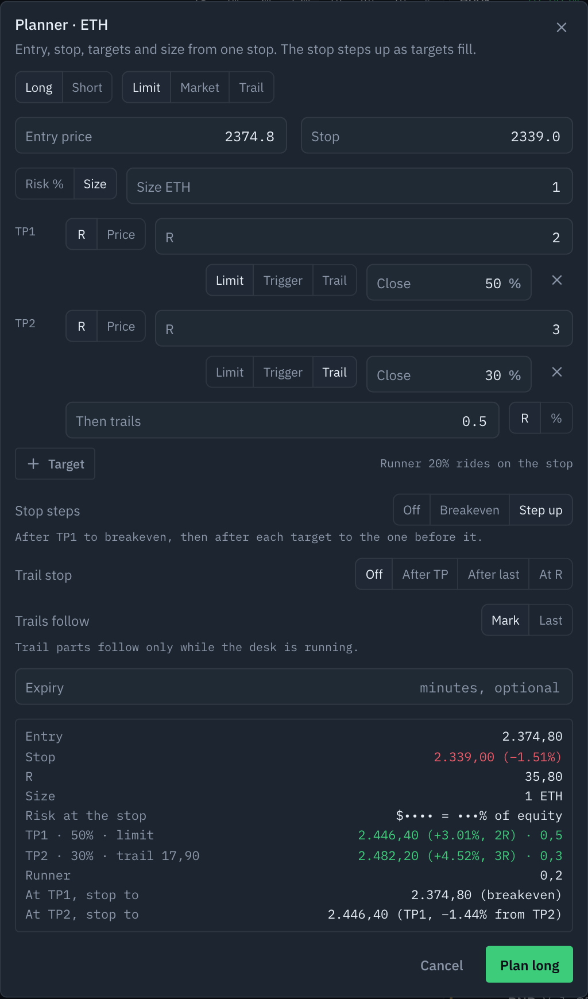
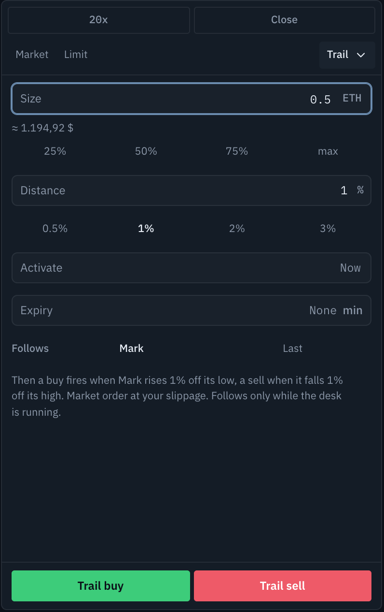

# Mayedge

Personal perp trading desk — Python backend + React frontend. Lighter only.



Personal software, not a product. There is no login: anyone who can reach the HTTP port can trade. The desk only answers to its own page: other sites open in your browser are refused by Host and Origin. Not financial advice.

Desk language is [CONTEXT.md](CONTEXT.md). Every word in bold below means what it says there.

## Features

### Desk

The desk shows UTC everywhere, never local time: every clock, date and chart axis.

Resizable mosaic: Chart, Book, Trades, Order, Alerts, Liqs, Positions. Layout edit is opt-in. Positions has a Journal tab: each Market from flat to flat, net of fees and funding. **Open page** takes it to its own page at `/journal`, with the full summary and a breakdown by Market and by algo.

**Header.** Next to MARGIN, **Today** is the **Portfolio**'s change since 00:00 UTC: Perps, Spot, LLP and LIT staking, net of deposits and withdrawals, from the venue's own PnL. It opens `/portfolio`: the total, allocation, value over time with each **Flow** marked, daily change, and what each Holding is made of. Rules: [docs/portfolio-rules.md](docs/portfolio-rules.md).

**Header.** Market picker, **Favorites**, mark, funding in APR, **Open interest**, margin, and feed status. Hover funding for its 7-day, 30-day and 1-year **Funding average**. When Lighter itself is down (HTTP 503, or a 1012 service-restart close), the status says so and since when, instead of a plain reconnect.

### Chart panel

One panel, three modes — not extra mosaic tiles.

- **Price chart** — candles, volume, Top of Book, with optional Open interest and **Fund pane**s underneath. **Pinned timeframes** (cap 7), including custom ones folded from a native resolution. **MayRekt** colors each candle by its **Tone**. Working Tickets draw on the chart: drag the line to Amend, click X to cancel. Clips, Planner and Trail lines are display-only. Armed **Axis** click on the price scale rests a GTT Ticket at Quick size (below live price buys, above sells).
- **Scan** — four boards of the liquid perps. Nothing on Scan alerts.
  - **Relative Strength** vs BTC.
  - Liquidation heat over a 1h / 4h / 24h / 7d / 30d window: **Window share**, **Liquidation intensity**, **Largest liquidation**.
  - **Activity** — what every liquid perp's tape shows now: the 5m move and its share of the **Day range**, the volume multiple, the 5m change in open interest, funding and premium.
  - **Tones board** — perps whose last closed bar on a **Tone timeframe** (default 30m and 4h, at most two) is blue or orange.
- **Watch** — **Path** charts for a **Watch Set** (cap 8), up to four **Watch panes**. Can undock to its own window; the popout shares the desk feed and dies with the desk tab.

| Price chart with MayRekt, OI and Fund panes | Scan · Activity |
|---|---|
|  |  |
| **Scan · Liquidations** | **Scan · Tones** |
|  |  |

### Alerts

An Alert states a fact and leaves the call to you ([ADR 0013](docs/adr/0013-an-alert-is-a-fact-and-a-toast-is-a-coincidence.md)). Kinds:

- **Spike** in price, volume or open interest: a minute at least N times the hour's biggest minute ([ADR 0014](docs/adr/0014-a-spike-is-a-multiple-of-the-hours-biggest-minute.md)).
- **Liquidations** sized against open interest.
- **Board** — a **Broad move**; while one is on, other markets are judged on their **Excess move**.
- **Near liquidation** on a Position.

Only liquid perps alert, plus any **Held market**, which always toasts. Rules that fire on a market within 2 minutes are one row. Show All or Urgent, Favorites only, mute a market. The **Funding strip** above the list names every market whose funding is far from its own day; it raises nothing.

Every row is written to the desk database. **Left** and **Against** score it from the price it fired at over the next 15 minutes ([ADR 0012](docs/adr/0012-an-alert-is-scored-from-the-price-it-fired-at.md)), and **Opened** counts the ones you clicked through. The panel shows each rule's 24h record. Every threshold is a knob in [`backend/config/alerts.yaml`](backend/config/alerts.yaml); the rules are [docs/alert-rules.md](docs/alert-rules.md).



### Pushes

A **Push** repeats a fact to Telegram when no tab is open. It raises nothing and it never places, amends, or cancels an order. The events, the texts, and the knobs are [docs/push-rules.md](docs/push-rules.md). Nothing is sent until both variables below are set.

1. In Telegram, message `@BotFather` → `/newbot` → copy the token.
2. Send your new bot any message, then open `https://api.telegram.org/bot<token>/getUpdates` and copy `message.chat.id`.
3. Put `TELEGRAM_BOT_TOKEN=` and `TELEGRAM_CHAT_ID=` in `backend/.env`, then `make push-env && make deploy`.
4. Use **Send test** in the Alerts panel. The line is there only once pushes are on.

#### When the desk was not watching

A boot after more than `down_after_s` (60 seconds) says how long the desk was down, whether it stopped cleanly, and that Trails, Planner trailing parts and Auto kill were not watching. Venue stops held. A pause that does not restart the process sends a Freeze push when the loop wakes. An optional Heartbeat pings a dead-man's-switch URL while the desk is healthy, and stays off until `HEARTBEAT_URL` is set in `backend/.env`. Any service that takes a GET ping works (Healthchecks.io, Cronitor, Better Stack). A period of 2 minutes and a grace of 3 minutes, with that service's own Telegram pointed at the same chat, is a reasonable start. The desk skips a ping when a feed is down, the loop is late, or the venue is down, so the service's grace period does the alerting. The URL is a secret: it is not logged and it is not in `/api/health`. The same URL works when the desk moves to the VPS.

### Execution

Market and limit Tickets from the Order panel, typed in the asset or in USD (**Notional**). Floating Buy/Sell are market at **Quick size** (the same size Axis rest uses). From a Positions row: **Stop** and **Take Profit** Tickets (Market or Limit), a Trail Stop or Trail Take Profit, or a Planner. On the Orders tab, **Bids** and **Asks** cancel Tickets of that side in the current All/Market scope; Clips stay with the algo. Size on a working order can be edited in place (**Amend**).

**Kill** stops all algos then cancels working orders; flatten is optional, not implied. **Auto kill**, armed from the Kill menu, does the same plus a flatten when total uPnL crosses a loss floor or a profit target. The flatten is retried at wider slippage while a Position stays open.

The Positions panel has Positions, Assets, Orders, Algos and History tabs; History shows your trades and the funding each Position paid. Each Position shows its **Realized**: what it has closed since it opened, less fees, from the Journal ([journal-rules.md](docs/journal-rules.md#on-a-position)). uPnL, Realized and Funding add up to the whole Position.

### Algos

Every algo works in **Clips**, not Tickets, and persists in SQLite; start, pause and stop from the blotter.

| Algo | What it does | Start from |
|---|---|---|
| **Chase** | One post-only Clip behind the touch, requoted as the book walks, up to a cap. | Order panel → Algo |
| **Grid** | Chases inside a price band, takes profit with reduce-only Clips. | Order panel → Algo |
| **Ladder** | Keeps N live rungs on static prices; refills on fill. | Order panel → Algo |
| **TWAP** | Slices a parent size across time. | Order panel → Algo |
| **Planner** | Runs one trade from its stop: entry, stop, targets, **Stop steps**. On an open Position it attaches instead: it takes over the exit and enters nothing. | Order panel → Algo, or a Positions row's Plan |
| **Trail** | Keeps a trigger a set distance behind the **best price**. Entry, Stop or Take Profit. | Order panel → Algo (Entry), or a Positions row (Stop, Take Profit) |

Grid and Planner will not start on a Market that already has another desk algo live ([ADR 0002](docs/adr/0002-grid-is-exclusive-on-a-market.md)), and a Trail will not start beside either; Planner runs its own trailing parts. Each family has its own client_order_index band ([ADR 0004](docs/adr/0004-partitioned-client-order-index.md)).

| Planner: limit entry, 2R limit target, 3R trailing target, Step up | Trail Entry from the Order panel |
|---|---|
|  |  |

Screenshots are the live desk with account figures masked.

### Data

Lighter WebSocket fan-out. Public market data works without keys. Testnet or mainnet via `LIGHTER_NETWORK` in backend `.env`.

The desk keeps its own history in SQLite: **OI samples** for 30 days then **OI hours** for good, **Liquidation days**, **Funding estimates** for 30 days, and **Funding prints** for good. Five minutes after boot, then daily, the **Funding backfill** reads up to a year of funding for each perp not yet filled, and writes only when the venue's latest rows match the prints the desk recorded itself.

#### Backups

The desk writes a daily **Backup** at 03:30 UTC into `backups/` next to `docker-compose.yml`, on the host outside Docker, and keeps the newest 7. `make backup` takes one now.

```bash
docker compose down            # never -v
gunzip -k backups/mayedge-2026-10-21.db.gz
docker run --rm -v mayedge_mayedge-data:/data -v "$PWD/backups":/b alpine \
  sh -c 'cp /b/mayedge-2026-10-21.db /data/mayedge.db && rm -f /data/mayedge.db-wal /data/mayedge.db-shm'
docker compose up -d
```

## Docs

| Doc | What's in it |
|---|---|
| [CONTEXT.md](CONTEXT.md) | The desk's language. Words in bold anywhere mean what it says. |
| [docs/alert-rules.md](docs/alert-rules.md) | Every alert, the funding strip and the Scan boards: rule, knob and the test that pins it. |
| [docs/push-rules.md](docs/push-rules.md) | Every Telegram push: event, text, debounce and knob. |
| [docs/journal-rules.md](docs/journal-rules.md) | How fills become Round trips, and how Net and R are counted. |
| [docs/planner-rules.md](docs/planner-rules.md) | What Planner does, start to finish. |
| [docs/trail-rules.md](docs/trail-rules.md) | What a Trail does, start to finish. |
| [docs/trail-scope.md](docs/trail-scope.md) | The reasoning behind Trail. Where it and the rules differ, the rules win. |
| [docs/lighter-limits.md](docs/lighter-limits.md) | Lighter's order, rate and nonce limits, and how the desk stays inside them. |
| [docs/adr](docs/adr) | Hard-to-reverse calls, one per file. |
| [deploy/README.md](deploy/README.md) | VPS + Tailscale Serve setup, ACL and checks. |

Rules docs are written before the code ([ADR 0011](docs/adr/0011-alert-rules-are-written-down-before-they-are-coded.md)): change the rule, then the code and the test that pins it, in one commit.

## Production

A VPS with **Tailscale Serve only**. Setup, ACL, and checks: **[deploy/README.md](deploy/README.md)**.

```bash
cp backend/.env.example backend/.env   # fill keys if trading
make push-env
make deploy
make check
```

Compose publishes `127.0.0.1:14200` (not `0.0.0.0`). Do not Funnel. Do not expose `:14200` on the public NIC.

**Local dev:** `uv run mayedge` binds `127.0.0.1:8000`. Vite proxies `/api` and `/ws` to the Docker port `:14200` unless `MAYEDGE_BACKEND` says otherwise. Or `make up` for the same Docker image as production.

## Quick start (local dev)

### Backend

```bash
cd backend
cp .env.example .env
# Optional: add LIGHTER_ACCOUNT_INDEX, LIGHTER_API_KEY_INDEX (2-254), LIGHTER_API_PRIVATE_KEY
uv sync
uv run mayedge
```

API runs at `http://127.0.0.1:8000`. Public market data works without credentials.

### Frontend

```bash
cd web
npm install
MAYEDGE_BACKEND=http://127.0.0.1:8000 npm run dev
```

Drop `MAYEDGE_BACKEND` when the backend is the Docker one from `make up` (`:14200`).

Open `http://localhost:5173`.

### Checks

`make ci` runs what GitHub Actions runs: ruff, basedpyright and unittest for the backend; lint, vitest and build for the web.

## API key setup (Lighter)

Use the [lighter-python examples](https://github.com/elliottech/lighter-python/blob/main/examples/README.md) `system_setup.py` with API key index **2–254** (not 0/1, reserved for the official app).

## Algos in detail

Algos work in **Clips** (child working orders). Tickets on the chart are operator-placed; dragging a Ticket Amends it, a Clip does not.

### Chase

Accumulate or distribute via one-sided post-only Clips behind the touch. Amends in place (no cancel+replace). Pulls Clips when the book or account feed is unhealthy or price leaves your band. Stops when the parent size is filled.

Chase jobs persist in SQLite. On shutdown, venue Clips are **pulled**; on restart the parent **auto-resumes quoting** once market and account feeds are healthy (remaining qty is the source of truth). Dirty crash leftovers are pulled on boot; Resume/restore credit REST trades before quoting.

### Grid

Chases inside a price band and takes profit with reduce-only Clips. Exclusive on a Market: will not start if another desk algo is already live there.

### Ladder

Keeps N live rungs on static prices across a range; refills on fill.

### TWAP

Slices a parent size across time into Clips.

### Planner

Runs one trade from its stop. Enter sends the entry (Market, Limit, Trail; Chase, which works it post-only behind the touch inside a band and is sized from the band's worst fill; or Ladder, which rests 2 to 20 post-only rungs at once, sized by **Strength** like the Ladder algo, and is sized so every rung filling loses the risk at the stop); Attach takes over an open Position. The stop goes on with the first fill and the targets once the entry ends; **Protect now** ends it early. Picking Planner while the ticket is on Chase or Ladder carries its fields and size over. Size comes from a risk % of equity, every number is measured in **R**, and the stop is tied to the Position. Each target is a resting Limit, a Trigger, or a Trail. **Stop steps** move the stop to **Breakeven** after the first target, or Step up to each earlier target's price; the **Runner** can trail. Its stop and targets stay on the venue through a desk restart. Rules: [docs/planner-rules.md](docs/planner-rules.md).

### Trail

Lighter has no trailing order, so the desk moves one ([ADR 0016](docs/adr/0016-a-trail-is-moved-by-the-desk.md)). A Trail follows Mark or Last (each print), waits for an optional **Activation**, and keeps its trigger the **Trail distance** (% or price) behind the **best price**. It never moves back.

- **Entry** — the desk holds the trigger and sends a Market order when price comes back. Has an expiry.
- **Stop** — a reduce-only Stop on the venue, Amended toward profit. Replaces the Market's Stop Tickets. On stop, keep it as a plain Stop Ticket or cancel it.
- **Take Profit** — a share of the Position; nothing is on the venue until Activation.

On Last the desk fires, and a venue **Backstop** one step behind holds the exit while the desk is down. **A Trail follows only while the desk is running**: a venue stop holds at the last price it was moved to, and an entry waits. Rules: [docs/trail-rules.md](docs/trail-rules.md).

## Notes

- Docker publishes `127.0.0.1:14200` → app `:8000` (API, `/ws`, and the SPA). Remote access is Tailscale Serve.

## License

MIT. See [LICENSE](LICENSE).
